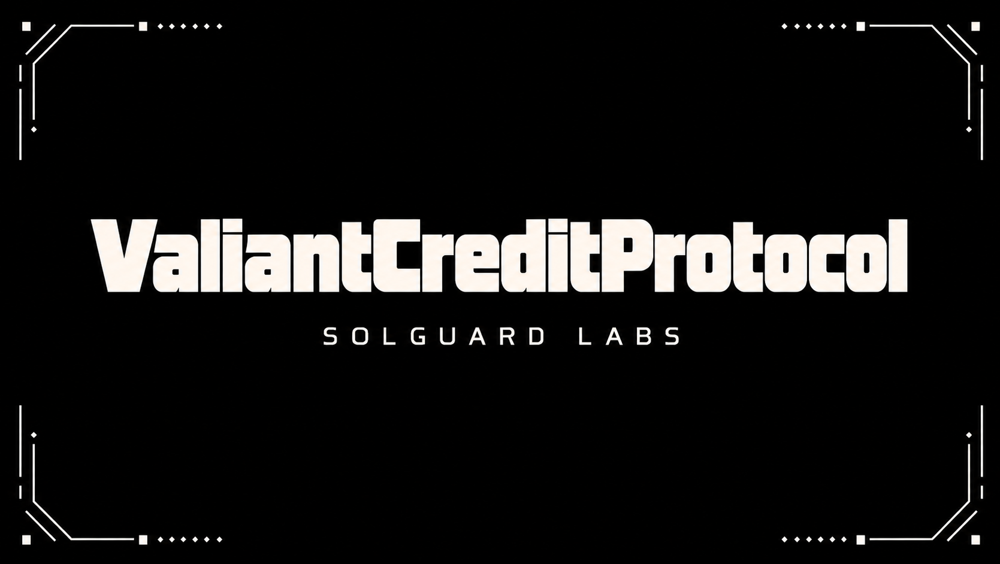
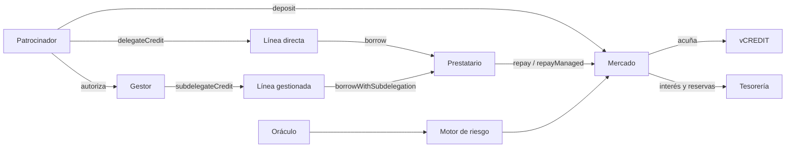

# ValiantCreditProtocol



Mercado de crédito delegado sobre EVM. Los patrocinadores aportan el activo, conservan la titularidad del colateral y autorizan préstamos mediante líneas directas o gestionadas. La admisión combina valoración, límite de línea y liquidez; la deuda puede consultarse por cuenta y ruta.

## Funcionamiento



El contrato principal es `src/ValiantCreditProtocol.sol`. Los módulos de `src/risk/`, `src/interest/`, `src/oracle/`, `src/treasury/` y `src/lens/` separan valoración, tipos y lectura. `client/ValiantPositionClient.js` ofrece una vista de solo lectura para preparar operaciones directas; no firma ni envía transacciones.

## Modelo económico

Con precio `P`, decimales del oráculo `d`, colateral `C` y factor `f` en puntos básicos:

```text
capacidad ≈ C × P / 10^d × f / 10 000
crédito disponible = max(0, capacidad − deuda de la cuenta)
importe directo orientativo = min(crédito disponible, límite restante, liquidez)
```

La deuda se registra escalada por el índice global. El tipo de préstamo sigue una curva de utilización con un tramo hasta `kink` y otro de mayor pendiente por encima. Las reservas reciben la fracción configurada del interés. Ejemplo: con 1 000 de colateral, precio 1, factor 75 %, deuda 150 y una línea de 400 que ya utilizó 150, la capacidad es 750, el crédito disponible 600 y la línea restante 250. Con liquidez suficiente, una lectura directa puede preparar hasta 250 adicionales. La transacción debe recalcular el estado vigente.

## Desarrollo

Requisitos: Bun 1.3.14, Git y Bash. Contratos Solidity 0.8.24; compilación y tests con Hardhat.

```bash
bun install --frozen-lockfile
bun run build
bun run test
bun run fmt:check
bash scripts/ci.sh
```

Las pruebas cubren depósitos, líneas, límites, revocaciones, deuda, repagos, intereses y liquidaciones. CI ejecuta las mismas comprobaciones en solicitudes de cambio y referencias de entrega.

## Documentación

- [Arquitectura y componentes](./docs/arquitectura.md)
- [Modelo económico](./docs/modelo-economico.md)
- [Integración del cliente](./docs/integracion.md)
- [Operación y controles](./docs/operacion.md)
- [Política de seguridad](./SECURITY.md)

Una referencia de entrega no constituye por sí sola un despliegue en una red externa. Licencia: [MIT](./LICENSE).
