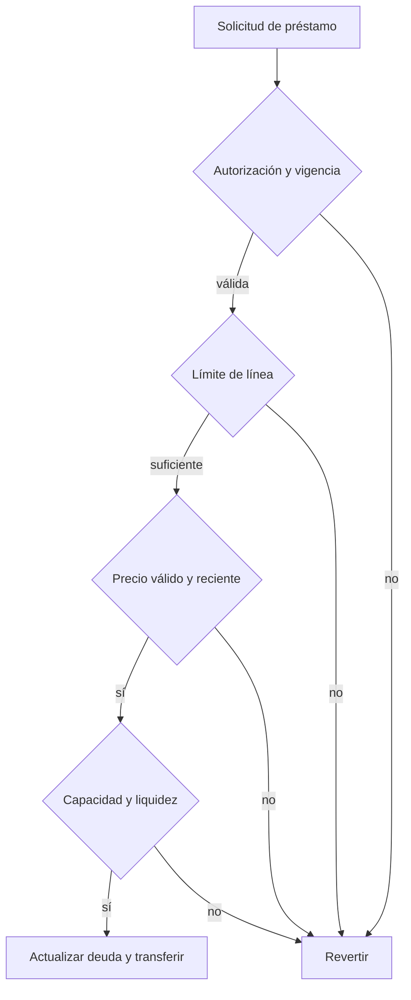

# Seguridad

## Superficie y garantías

El alcance técnico comprende contratos bajo `src/`, integraciones de oráculo y tipos, scripts de validación y cliente de lectura. Las líneas exponen límites, caducidad y revocación; los préstamos comprueban liquidez, capacidad, límites de mercado y estado de pausa. Los repagos y liquidaciones deben conservar la coherencia de ruta, prestatario, cuenta de exposición y deuda total.



El cliente de lectura ofrece una estimación puntual; la ejecución debe repetir las comprobaciones. Los administradores de riesgo pueden cambiar parámetros y dependencias: esas facultades requieren revisión de configuración y separación de claves. Este repositorio no acredita una auditoría ni un despliegue externo.

## Comunicación responsable

Utilice la opción privada **Report a vulnerability** de GitHub si está habilitada; si no, contacte a los mantenedores por un canal privado antes de publicar detalles. Incluya commit, componente, condiciones iniciales, transiciones reproducibles, impacto económico medido y pruebas que distingan lo esperado de lo no autorizado. No envíe secretos ni datos de terceros.

Los informes se priorizan por impacto reproducible, permisos necesarios y posibilidad de mitigación. No se prometen plazos ni recompensas no publicados. Una prueba local no demuestra exposición de fondos en una red externa.

```bash
bun install --frozen-lockfile
bash scripts/ci.sh
```

Consulte [operación y controles](./docs/operacion.md) para las referencias de entrega.
