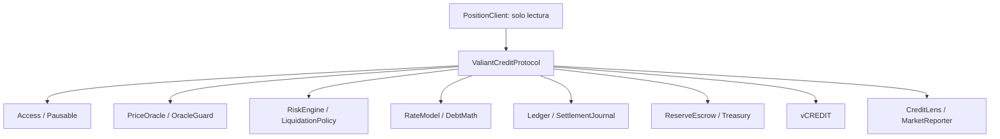

# Arquitectura

ValiantCreditProtocol separa custodia, autorizaciones y exposición crediticia. `deposit` transfiere el activo al mercado y acuña `vCREDIT`; `withdraw` reduce colateral y comprueba que la posición conserve capacidad suficiente. Las líneas directas asocian patrocinador y delegado; las gestionadas añaden gestor y prestatario. Cada línea conserva límite, uso, vigencia y estado.

El libro principal es el contrato de mercado. Las vistas `accountSnapshot`, `creditLine`, `managedLine`, `routeDebt`, `marketState` y `availableLiquidity` permiten reconciliar posiciones. Los módulos auxiliares no sustituyen las comprobaciones de entrada. El oráculo entrega valor, decimales y marca temporal; la configuración fija la antigüedad máxima aceptada.

La liquidación pública opera sobre deuda directa: comprueba el umbral de salud, aplica el factor de cierre y calcula el colateral entregado con el bonus configurado.
